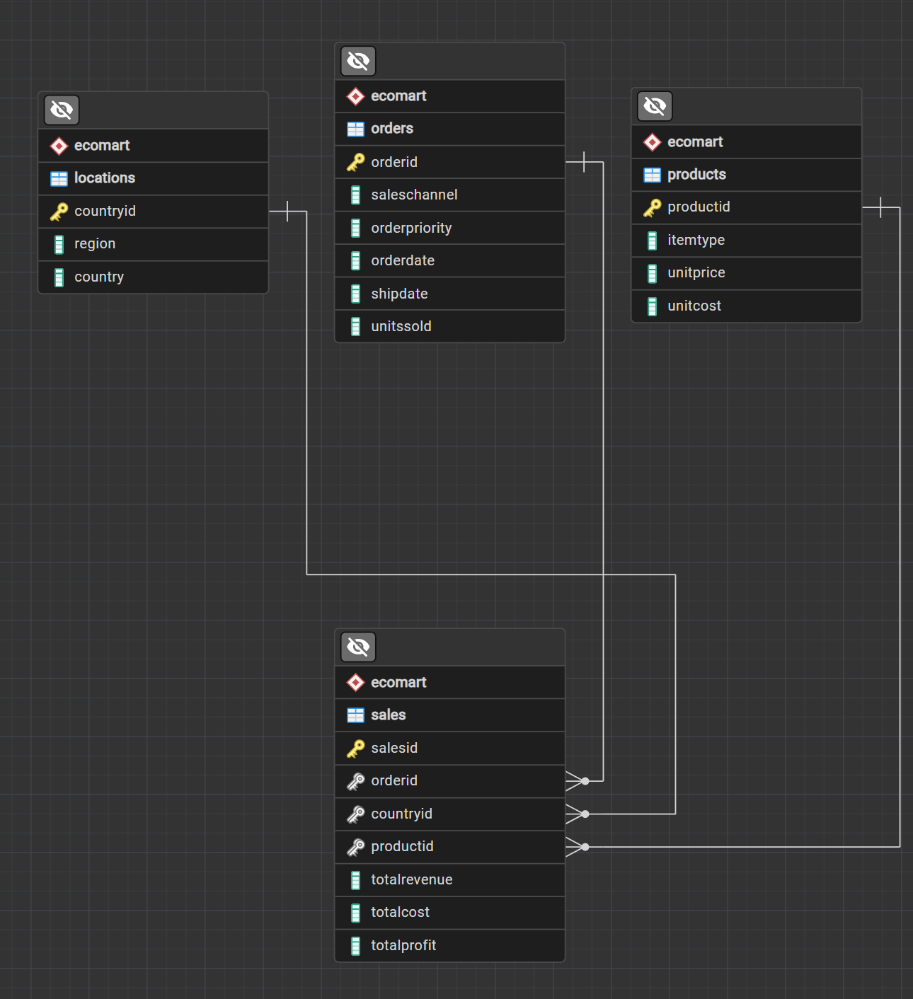

# Designing SQL database for online retailer

## Executive Summary
Using PostgreSQL, I designed and created a SQL database from scratch for an online retailer. Starting with a flat excel file from an online retailer containing data from customer orders. Prioritizing efficiency and minimizing data redundancy, I created multiple normalized tables for the retailer's data. Then data was imported into the database structure and used to perform multiple queries. Those queries were then optimized using techniques including indexing.

### Business Problem
EcoMart requires a flexible, scalable, and secure database solution to accommodate dynamic product data (pricing, attributes, sustainability certifications, reviews), handle growing data volumes/traffic without compromising performance, and ensure proactive security and maintenance.

### Methodology
**Proposed Solution & Data Structure**
- Technology: PostgreSQL Relational Database Management System (RDBMS)
- Schema Design: Structured into four interconnected tables (Locations, Orders, Products, and Sales) linked by keys to minimize data redundancy and optimize query efficiency

**Key Justifications**
- Flexibility & Scalability: Structured relational tables eliminate flat-file redundancies, making it easier to expand product offerings while scaling both vertically and horizontally to manage high traffic
- Security & Performance: Built-in PostgreSQL features provide data encryption, robust security controls, and proactive performance monitoring to resolve query bottlenecks and vulnerabilities before impacting users

### Skills
- PostgreSQL database design & architecture: design relational schemas, define primary/foreign keys, establish relationships among tables
- SQL: joins, aggregate functions, sorting/filtering
- Optimizing SQL queries: monitor query execution, utilize indexes

### Results
We created a RDMS for EcoMart to hold all data related to their products and orders. This database structure 
- reduces data redundancy
- improves data integrity
- allows for scalability
- provides flexibility for data expansion
- enhances security 
